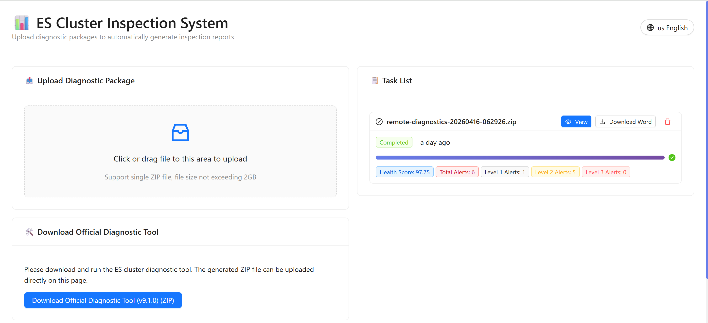
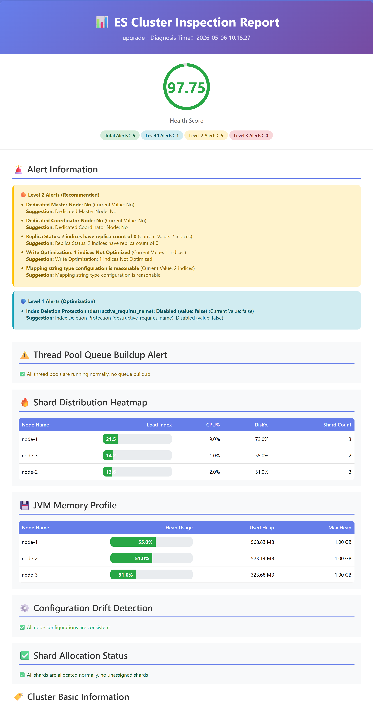
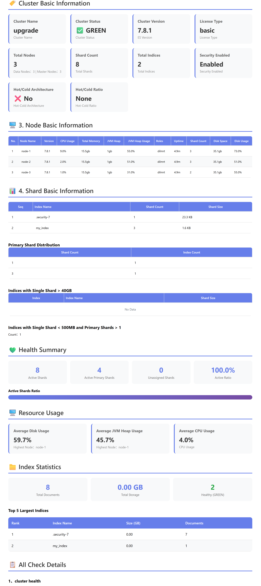
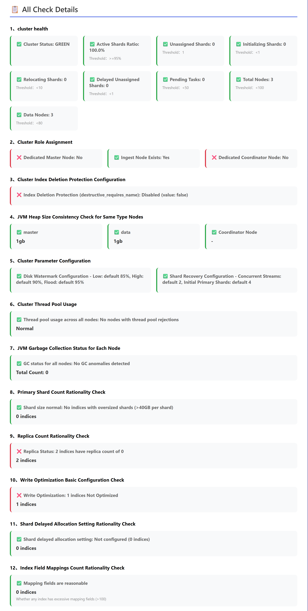
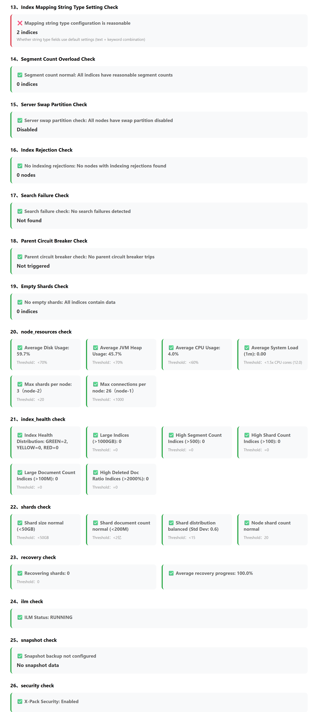

# ElasticLens - Elasticsearch クラスタ検査システム

<div align="center">

**Elasticsearch クラスタ検査結果の自動解釈Webプラットフォーム**



[](https://www.python.org/downloads/)
[](https://react.dev/)
[](https://flask.palletsprojects.com/)
[](LICENSE)

**言語:** [English](../README.md) | [简体中文](README.zh.md) | [Deutsch](README.de.md) | [Français](README.fr.md) | [Русский](README.ru.md)

</div>


---

## 📖 概要

ElasticLens は、Elasticsearch クラスタ検査結果の**可視化および分析プラットフォーム**です。このシステムは、**Elasticsearch 公式診断ツール**からエクスポートされた診断 ZIP パッケージを処理し、診断データを自動解析し、クラスタ状態を深層分析し、多次元の検査レポート（HTML / Word / JSON）を生成するように設計されています。

直感的な可視化表示を通じて、運用担当者がクラスタの健康状態を迅速に把握し、潜在的な問題を発見し、最適化提案を受け取ることを支援し、複雑な診断データを手動で分析する必要をなくします。

**Elasticsearch 公式診断ツール**: [elastic/support-diagnostics](https://github.com/elastic/support-diagnostics/)

### ✨ 主な機能

- 🌐 **Webプラットフォーム** - React + Flaskに基づくフルスタックWebアプリケーション、診断パッケージのドラッグ＆ドロップアップロードをサポート
- 📊 **多形式レポート** - HTMLおよびWord（.docx）形式の検査レポートを自動生成
- 🔍 **インテリジェント解析** - ES診断ZIPパッケージを自動解析、主要指標を抽出（クラスタヘルス、ノードリソース、インデックス詳細、ILM、スナップショット、セキュリティなど）
- 🧠 **深層分析** - ルールエンジンベースの健康度評価、リソース分析、アラート生成
- 🎯 **ヘルススコア** - 0-100の定量的スコアリングでクラスタ健康レベルを直感的に表示
- 🔔 **段階的アラート** - 三段階/二段階/一段階のアラートメカニズム（severity_level）
- ⚡ **非同期処理** - バックグラウンド非同期タスク処理、大容量ファイル（2GB）アップロードと長時間分析をサポート
- 📈 **可視化** - 円形ヘルススコアダッシュボード、プログレスバー、カードなどのビジュアル表示
- 📝 **多言語サポート** - 簡体字中国語、繁体字中国語、英語、日本語、フランス語、ドイツ語、ロシア語の7言語を完全サポート、インターフェースとレポートの自動切り替え

### 🌍 多言語サポート

システムは国際化（i18n）を包括的にサポートし、以下の7言語を提供します：

- 🇨🇳 **簡体字中国語 (zh-CN)** - デフォルト言語
- 🇹🇼 **繁体字中国語 (zh-TW)** - 完全翻訳
- 🇺🇸 **英語 (en-US)** - 完全翻訳
- 🇯🇵 **日本語 (ja-JP)** - 完全翻訳
- 🇫🇷 **フランス語 (fr-FR)** - 完全翻訳
- 🇩🇪 **ドイツ語 (de-DE)** - 完全翻訳
- 🇷🇺 **ロシア語 (ru-RU)** - 完全翻訳

**機能特徴：**
- ✅ フロントエンドUIインターフェースの動的言語切り替え（ホーム、タスクリスト、レポート、アップロード、履歴、設定）
- ✅ バックエンドレポート生成が多言語をサポート（HTML + Word形式）
- ✅ 言語設定を自動保存、次回アクセス時に自動適用
- ✅ Ant Designコンポーネントライブラリが多言語に自動適応
- ✅ スマート翻訳関数が動的コンテンツを処理（例：「5個のインデックス」→「5インデックス」→「5 indices」など）
- ✅ 動的メッセージのスマートマッチングと自動翻訳フォールバックメカニズム

**使用方法：**
ホームページタイトルの右側にある言語切り替えボタンをクリックし、希望する言語を選択してください。

---

## 🏗️ システムアーキテクチャ

```
┌─────────────────┐      REST API      ┌─────────────────┐
│   フロントエンド  │ ◄───────────────► │   バックエンド    │
│   (React)        │                    │   (Flask)        │
│                 │                    │                 │
│ - ファイルアップロード│                  │ - タスク管理     │
│ - タスク追跡     │                    │ - 非同期処理     │
│ - レポート表示   │                    │ - レポート生成   │
│ - 履歴           │                    │ - ファイル管理   │
└─────────────────┘                    └────────┬────────
                                                │
                                                ▼
                                    ┌────────────────────┐
                                    │  es_insight コアモジュール│
                                    │                     │
                                    │ - 診断データ抽出     │
                                    │ - ルールエンジンチェック│
                                    │ - ヘルススコア計算   │
                                    │ - HTML/Wordレポート生成│
                                    └────────┬───────────┘
                                             │
                                             ▼
                                    ┌────────────────────┐
                                    │  SQLite データベース  │
                                    │                     │
                                    │ - タスクメタデータ   │
                                    │ - レポートメタデータ │
                                    │ - クエリと統計       │
                                    └────────┬───────────┘
                                             │
                                             ▼
                                    ┌────────────────────┐
                                    │  ファイルシステム     │
                                    │                     │
                                    │ - アップロードされたZIP│
                                    │ - JSONレポート      │
                                    │ - HTMLレポート      │
                                    │ - Wordレポート      │
                                    └────────────────────┘
```

---

## 🚀 クイックスタート

### 環境要件

- **Python**: 3.9+
- **Node.js**: 18+ (フロントエンド開発/ビルド)
- **npm**: 9+ (フロントエンドパッケージ管理)
- **オペレーティングシステム**: Windows 10+/Linux/macOS

### 方法一：Webプラットフォーム（推奨）

#### 🐳 Dockerデプロイメント（本番環境に推奨）

Docker Composeを使用してフロントエンドとバックエンドサービスをワンクリックでデプロイ：

```bash
# プロジェクトルートディレクトリで実行
cd elasticlens

# すべてのサービスを開始（フロントエンド + バックエンド）
./start.sh

# または手動で実行
docker compose up -d
```

**アクセスURL：**
- フロントエンドインターフェース：http://localhost:8080
- バックエンドAPI：http://localhost:5001

**利点：**
- ✅ PythonおよびNode.js環境のインストール不要
- ✅ すべての依存関係を自動処理
- ✅ データ永続化（データベース、アップロードファイル、レポート）
- ✅ ヘルスチェックと自動再起動
- ✅ 本番環境デプロイに適している
- ✅ イントラネットオフラインデプロイをサポート

詳細なデプロイガイドについては、以下を参照してください：[イントラネットオフラインDockerデプロイ方案.md](内网离线Docker部署方案.md)

---

#### 従来型デプロイ（ローカル開発）

##### 1. バックエンド依存関係のインストール

```bash
cd backend
pip install -r requirements.txt
```

バックエンド依存関係包括：
- Flask 3.0.0 - Webフレームワーク
- Flask-CORS 4.0.0 - クロスオリジンサポート
- python-docx >= 1.0.0 - Wordレポート生成
- loguru 0.7.2 - ログ管理
- weasyprint >= 60.0 - PDFレンダリング（オプション）
- SQLite3 - データベース（Python組み込み、ゼロ設定）

#### 2. フロントエンド依存関係のインストール

```bash
cd frontend
npm install
```

フロントエンド依存关系包括：
- React 18.2 + TypeScript
- Ant Design 5.12 - UIコンポーネントライブラリ
- Vite 5.0 - ビルドツール
- Axios 1.6 - HTTPクライアント
- Zustand 4.4 - 状態管理
- Recharts 2.10 - チャートライブラリ

##### 3. サービス開始

**バックエンド開始**（プロジェクトルートディレクトリ）：
```bash
cd backend
python app.py
```
バックエンドサービスは `http://localhost:5000` で実行

**フロントエンド開始**（プロジェクトルートディレクトリ）：
```bash
cd frontend
npm run dev
```
フロントエンドサービスは `http://localhost:5173` で実行

#### 4. Webプラットフォームの使用

1. ブラウザで `http://localhost:5173` を開く
2. ドラッグ＆ドロップまたはクリックしてES診断ZIPファイルをアップロード
3. 非同期分析が完了するのを待つ
4. 検査レポートを表示（HTML表示）
5. 「Wordダウンロード」ボタンをクリックしてWord形式レポートをエクスポート

### 方法二：コマンドラインツール（CLI）

#### インストール

```bash
pip install -r requirements.txt
pip install -e .
```

#### 基本使用方法

```bash
# 診断パッケージを解析してレポートを生成
es-insight data/local-diagnostics-*.zip

# 出力ディレクトリを指定
es-insight data/local-diagnostics-*.zip -o ./reports

# 出力形式を指定
es-insight data/local-diagnostics-*.zip -f html,json

# カスタム設定を使用
es-insight data/local-diagnostics-*.zip -c configs/checkpoints_thresholds_complete.yaml
```

#### Pythonスクリプトの使用

```bash
# ワンクリックで診断ZIPパッケージを処理
python process_diagnostic_zip.py

# HTMLレポートを生成
python generate_html_report.py data/local-diagnostics-*.zip
```

---

## 📁 プロジェクト構造

```
検査項目読み取り/
├── backend/                    # Flask バックエンドサービス
│   ├── app.py                  # メインサービスファイル（ファイルアップロード、タスク管理、レポート生成 API）
│   ├── version.py              # バージョン設定（v1.0.9）
│   ├── db_server/              # データベースサービスモジュール
│   │   ├── __init__.py         # パッケージ初期化
│   │   ├── database.py         # データベース初期化と接続管理
│   │   └── models.py           # データモデル操作カプセル化（TaskModel, ReportModel）
│   ├── es_insight.db           # SQLite データベースファイル（自動生成）
│   ├── migrate_*.py            # データマイグレーションスクリプト
│   ├── requirements.txt        # バックエンド依存関係
│   └── DEPLOYMENT.md           # デプロイメントドキュメント
│
├── frontend/                   # React フロントエンドアプリケーション
│   ├── src/
│   │   ├── api/                # API インターフェースカプセル化（Axios インスタンス、インターセプター）
│   │   ├── components/         # 共通コンポーネント（Upload、Task、Report）
│   │   ├── pages/              # ページコンポーネント（Home、Report、History、Settings）
│   │   ├── store/              # Zustand 状態管理
│   │   ├── hooks/              # カスタムフック（usePolling、useDownload）
│   │   ├── types/              # TypeScript 型定義
│   │   └── utils/              # ユーティリティ関数
│   ├── .env.development        # 開発環境変数
│   ├── .env.production         # 本番環境変数
│   ├── package.json
│   └── vite.config.ts          # Vite 設定（プロキシ、プラグイン）
│
├── es_insight/                 # コア分析エンジン
│   ├── parsers/                # データパーサー
│   │   ├── health_parser.py    # クラスタヘルス解析
│   │   ├── nodes_parser.py     # ノード情報解析
│   │   └── indices_parser.py   # インデックス情報解析
│   ├── analyzers/              # 分析エンジン
│   │   ├── health_engine.py    # ヘルス評価
│   │   └── resource_engine.py  # リソース分析
│   ├── rules/                  # ルールエンジン
│   │   └── engine.py           # しきい値チェックとアラート生成（50+ ルール）
│   ├── models/                 # データモデル
│   ├── diagnostic_extractor.py # 診断 ZIP パッケージ抽出器
│   ├── parse_check_result.py   # チェック結果解析（ヘルススコア計算）
│   ├── report_generator.py     # 多形式レポートジェネレーター
│   ├── generate_html_report.py # HTML レポート生成
│   └── cli.py                  # コマンドラインインターフェース
│
├── configs/                    # 設定ファイル
│   ├── checkpoints_thresholds_complete.yaml  # チェック項目しきい値設定（完全版）
│   ├── default_thresholds.yaml               # デフォルトしきい値
│   ├── default_report.yaml                   # レポート設定
│   └── テストガイド.md
│
├── data/                       # テストデータディレクトリ
├── uploads/                    # アップロードされた ZIP ファイル（Web モード）
├── out/                        # 分析中間出力
├── reports/                    # 生成されたレポートファイル
├── doc/                        # ドキュメントディレクトリ
│   ├── フロントエンド設計/       # フロントエンド設計ドキュメント
│   └── バックエンド設計/         # バックエンド設計ドキュメント
└── tests/                      # テストケース
```

---

## 📊 検査項目概要

システムは**11の大カテゴリ**の検査指標をカバーし、**30+の具体的なチェック**を含みます：

| カテゴリ | 重み | チェック項目 |
|----------|------|-------------|
| **クラスタヘルス** | 30% | クラスタ状態、アクティブシャード比率、未割り当てシャード、初期化中シャード、再配置中シャード |
| **ノードリソース** | 25% | ディスク使用率、JVM ヒープ使用率、CPU 使用率、システム負荷、ノードあたりのシャード数 |
| **インデックスヘルス** | 20% | インデックスヘルス分布、大規模インデックス数、高セグメント数インデックス、高シャード数インデックス、大量ドキュメント数インデックス |
| **シャードチェック** | 5% | 単一シャードサイズ、単一シャードドキュメント数、シャード分布均衡度 |
| **回復チェック** | 5% | 回復中シャード数、平均回復進捗 |
| **ILM ポリシー** | 3% | ILM 状態チェック |
| **スナップショットチェック** | 3% | スナップショット設定と状態 |
| **セキュリティチェック** | 2% | X-Pack セキュリティ機能の有効化状況 |
| **テンプレートとマッピング** | 2% | インデックステンプレート、コンポーネントテンプレート、平均フィールド数 |
| **ログとエラー** | 2% | GC 回数、GC 時間統計 |
| **パフォーマンス情報** | - | クラスタ総ドキュメント数、クラスタ総ストレージサイズ（情報表示、スコアリングに含まれない） |

---

## ⚙️ 設定説明

### しきい値設定

コアしきい値設定ファイルは `configs/checkpoints_thresholds_complete.yaml` にあり、主な設定項目：

```yaml
# クラスタヘルス
cluster:
  status:
    green: none     # GREEN 状態はアラートなし
    yellow: warning # YELLOW 状態は警告
    red: critical   # RED 状態は深刻
  active_shards_percent:
    warning: 95     # 95% 未満は警告
    critical: 90    # 90% 未満は深刻

# ノードリソース
node:
  disk_usage_percent:
    warning: 70     # ディスク 70% は注意
    alert: 80       # ディスク 80% は水位線
    critical: 85    # ディスク 85% は書き込み拒否
  heap_used_percent:
    warning: 70     # JVM 70% は注意
    critical: 85    # JVM 85% は OOM リスク

# インデックスヘルス
index:
  size_gb:
    warning: 50     # 単一インデックス 50GB は注意
    critical: 100   # 単一インデックス 100GB は深刻
  docs_count:
    warning: 100000000    # 1億ドキュメントは注意
    critical: 500000000   # 5億ドキュメントは深刻
```

### ヘルススコア計算

```python
スコア = 100 - (深刻アラート数 × 20) - (警告数 × 5) - (情報数 × 1)
スコア範囲：0-100
```

| スコア範囲 | ヘルスレベル |
|------------|--------------|
| 90-100 | 🌟 優秀 |
| 75-89 | 👍 良好 |
| 60-74 | ⚠️ 普通 |
| 40-59 | 🔴 较差 |
| 0-39 | 🚨 深刻 |

---

## 📄 レポート出力

### HTML レポート

- 紫色グラデーションテーマデザイン
- 円形ヘルススコア可視化
- レスポンシブカードレイアウト
- アラート情報の段階的表示（Critical/Warning/Info）
- 全チェック項目詳細テーブル

### Word レポート (.docx)

- プロフェッショナルなレイアウト形式
- クラスタ基本情報テーブル
- ヘルス評価とスコアリング
- チェック項目詳細（合格/不合格状態、値、しきい値）
- アラート詳細の段階的リスト
- カラーコーディング（✅ 緑色合格、❌ 赤色不合格）

### JSON レポート

- 構造化データ
- `check_results` の完全なチェック項目詳細を含む
- 二次開発とデータ分析に便利

---

## 🔧 API エンドポイント

バックエンドは以下の REST API エンドポイントを提供します：

### タスク管理

| メソッド | エンドポイント | 説明 |
|---------|---------------|------|
| POST | `/api/v1/upload` | 診断 ZIP ファイルをアップロード、非同期タスクを作成 |
| GET | `/api/v1/tasks` | タスクリストを取得（ページネーション、削除済み除外） |
| GET | `/api/v1/tasks/<task_id>` | 単一タスクの詳細を取得 |
| DELETE | `/api/v1/tasks/<task_id>` | ソフト削除タスク（レポートのカスケード削除） |

### レポート管理

| メソッド | エンドポイント | 説明 |
|---------|---------------|------|
| GET | `/api/v1/reports` | レポートリストを取得（フィルタリングとページネーションをサポート） |
| GET | `/api/v1/reports/statistics` | レポート統計情報を取得 |
| GET | `/api/v1/reports/<report_id>` | レポート JSON データを取得 |
| GET | `/api/v1/reports/<report_id>/html` | HTML レポート内容文字列を取得 |
| GET | `/api/v1/reports/<report_id>/view` | HTML レポートを直接表示（iframe） |
| GET | `/api/v1/reports/<report_id>/download?format=word` | Word レポートをダウンロード |
| GET | `/api/v1/reports/<report_id>/download?format=json` | JSON レポートをダウンロード |
| GET | `/api/v1/reports/<report_id>/download?format=html` | HTML レポートをダウンロード |

### システムエンドポイント

| メソッド | エンドポイント | 説明 |
|---------|---------------|------|
| GET | `/api/v1/health` | ヘルスチェック（バージョン情報を返す） |

---

## 🧪 テスト

```bash
# ユニットテストを実行
pytest tests/

# 特定のテストを実行
pytest tests/unit/test_health_parser.py

# カバレッジレポート付き
pytest --cov=es_insight --cov-report=html
```

---

## 📦 依存関係リスト

### バックエンドコア依存关系

| パッケージ | バージョン | 用途 |
|-----------|-----------|------|
| Flask | 3.0.0 | Webフレームワーク |
| Flask-CORS | 4.0.0 | クロスオリジンサポート |
| Werkzeug | 3.0.1 | WSGI ツールキット |
| python-docx | >= 1.0.0 | Wordレポート生成 |
| click | 8.1.7 | CLI フレームワーク |
| pyyaml | >= 6.0 | YAML 設定解析 |
| loguru | 0.7.2 | ログ管理 |
| orjson | >= 3.6.0 | 高性能 JSON |
| weasyprint | >= 60.0 | PDF レンダリング（オプション） |
| SQLite3 | Python 組み込み | データベースストレージ |

### フロントエンドコア依存关系

| パッケージ | バージョン | 用途 |
|-----------|-----------|------|
| React | 18.2 | UI フレームワーク |
| TypeScript | 5.2 | 型システム |
| Ant Design | 5.12 | UI コンポーネントライブラリ |
| Vite | 4.x | ビルドツール |
| Axios | 1.6 | HTTP クライアント |
| Zustand | 4.4 | 状態管理 |
| React Router | 6.21 | ルート管理 |
| Recharts | 2.10 | チャートライブラリ |
| Day.js | 1.11 | 日付処理 |

---

## 🐛 トラブルシューティング

### 一般的な問題

#### 1. Word レポート生成失敗
```bash
# python-docx がインストールされているか確認
pip install python-docx>=1.0.0
```

#### 2. フロントエンド起動失敗
```bash
# Node.js >= 18 を確認
node -v
npm -v

# 依存関係を再インストール
cd frontend
rm -rf node_modules
npm install
```

#### 3. バックエンドポートが占有されている
```bash
# backend/app.py のポート番号を変更
# デフォルトポート：5000
```

#### 4. フロントエンドポートが占有されている
```bash
# frontend/vite.config.ts のポート番号を変更
# デフォルトポート：5173
```

#### 5. Windows 中国語パスの問題
- python-docx は Windows の中国語パスで互換性の問題がある可能性があります
- プロジェクトを英語パスに配置することをお勧めします

#### 6. データベースファイルの破損
```bash
# データベースファイルを削除、サービス再起動で自動再構築
cd backend
rm es_insight.db
python app.py
```
**注意**：これによりすべての履歴データが失われます。慎重に操作してください！

#### 7. タスク状態が更新されない
- バックエンドサービスが正常に実行されているか確認（`http://localhost:5000/api/v1/health` にアクセス）
- ブラウザコンソールでネットワークエラーを確認
- フロントエンドの API アドレスが正しいか確認（`.env.development`）

---

## 📚 ドキュメント

詳細なドキュメントについては `doc/` ディレクトリを確認してください：

| ドキュメント | 説明 |
|-------------|------|
| `doc/フロントエンド設計/README.md` | フロントエンドドキュメントナビゲーション |
| `doc/フロントエンド設計/フロントエンド设计方案.md` | フロントエンド技術選択とアーキテクチャ設計 |
| `doc/フロントエンド設計/フロントエンド実装ガイド.md` | フロントエンド詳細コード実装 |
| `doc/フロントエンド設計/バックエンドサービス設計.md` | Flask API 設計とデプロイメント |
| `doc/フロントエンド設計/フロントエンド要件.md` | 詳細要件仕様 |
| `configs/テストガイド.md` | テストケースと使用ガイド |

---

## 📜 変更ログ

詳細は [backend/CHANGELOG.md](backend/CHANGELOG.md) と [frontend/CHANGELOG.md](frontend/CHANGELOG.md) を参照してください

### v1.0.9 (2026-05-06)

- 🐳 **Docker デプロイメントサポートを追加**：フロントエンドとバックエンドのコンテナ化デプロイソリューションを実装
  - バックエンド Dockerfile：Python 3.11-slim ベース、イメージサイズを最適化（~567MB）
  - フロントエンド Dockerfile：マルチステージビルド、Nginx Alpine を使用（~45MB）
  - docker-compose.yml：サービスオーケストレーション、ヘルスチェック、データ永続化
  - start.sh / stop.sh：ワンクリック起動/停止スクリプト、Docker Compose V1/V2 と互換性
  - データ永続化ソリューションを改善：uploads、out、reports、db ディレクトリの Volume マウント
  - イントラネットオフラインデプロイメントドキュメントを追加：完全なパッケージング、転送、デプロイプロセス
  
- 🔧 **依存関係管理を最適化**：欠落している Python 依存関係パッケージを追加
  - pandas>=1.3.0、numpy>=1.20.0、pyyaml>=6.0、jinja2>=3.0.0、orjson>=3.6.0 を追加
  
- 🐛 **バグ修正**：
  - Debian Trixie パッケージ名の問題を修正
  - TypeScript コンパイルエラーを修正（未使用の Ant Design コンポーネントインポートを削除）
  - Docker volume マウントの競合を修正

### v1.0.8 (2026-04-30)

- 🌍 **多言語国際化サポートを追加**：システムはフランス語、ドイツ語、ロシア語を包括的にサポート
  - バックエンドレポート生成がフランス語 (fr-FR)、ドイツ語 (de-DE)、ロシア語 (ru-RU) をサポート
  - 約1065個の翻訳キーを一括追加（静的翻訳927個 + 動的フレーズ138個）
  - スマート翻訳関数 `translate_check_message()` を強化、46個の一般的なフレーズマッピングをサポート
  - HTML レポートの未翻訳テキストを99個から34個に削減（66% 改善）

### v1.0.7 (2026-04-30)

- 🇯🇵 **日本語国際化サポートを完善**：レポートに残っている中国語翻訳問題を徹底的に解決
  - `translations.py` に欠落している33個の静的翻訳キーを補充
  - 日本語翻訳の欠落を引き起こす `translations_map` の重複定義を修正
  - 動的値「不明」のスマート翻訳ロジックを実装
  
- 📊 **インデックスデータソース設定を最適化**：インデックス統計データの精度と一貫性を向上
  - インデックス基本情報データソースを `indices.json` からより正確な `indices_stats.json` に置き換え
  - シャード数とサイズ統計の権威あるソースとして `cat_shards.txt` の統一使用

### v1.0.6 (2026-04-29)

- 🇯🇵 **日本語国際化サポートを追加**：システムは日本語 (ja-JP) を包括的にサポート
  - バックエンドレポート生成が日本語翻訳をサポート（HTML + Word）
  - 約370個の日本語翻訳キーを追加、すべてのレポート内容をカバー
  - フロントエンド UI が4言語を完全にサポート（簡体字中国語、繁体字中国語、英語、日本語）
  
- 🐛 **Word レポート言語切り替えバグを修正**：言語切り替え後にダウンロードされた Word レポートは現在の言語を使用
  - 異なる言語は独立したファイル名を使用：`{report_id}_{lang}.docx`
  - 切り替え後にダウンロードがまだ古い言語を使用する問題を解決

### v1.0.5 (2026-04-27)

- 🔔 **三段階アラート分類システムを追加**：severity_level 検証レベルを導入
  - 🔴 レベル3アラート（必須処理）：severity_level=3、非常に深刻な問題
  - 🟡 レベル2アラート（処理推奨）：severity_level=2、一般的な問題
  - 🔵 レベル1アラート（最適化提案）：severity_level=1、深刻でない問題
  - ヘルススコアレポ各级別のアラート数統計を追加
  
- 📊 **アラート情報表示をリファクタリング**：「深刻/警告」の二段階から「レベル3/レベル2/レベル1」の三段階分類に変更
  - HTML と Word レポートのアラート情報を severity_level ごとにグループ化して表示
  - リストページにレベルごとのアラート数を表示（level_1_count、level_2_count、level_3_count）

### v1.0.4 (2026-04-27)

- 📈 **5つの高度な分析コンポーネントを追加**：HTML と Word レポートに深層分析機能を追加
  - ⚠️ スレッドプールキュー蓄積アラート：スレッドプールキューサイズと拒否数を監視
  - 🔥 シャード分布ホットスポット：シャード数、CPU%、ディスク%に基づいて負荷指数を計算
  - 💾 JVM メモリプロファイル：各ノードの JVM ヒープ使用率、使用済み/最大ヒープメモリを表示
  - ⚙️ 設定ドリフト検出：ノード間の主要な設定パラメータを比較、不整合を検出
  - ✅ シャード割り当て状態：未割り当てシャードを検出し、失敗理由を表示

### v1.0.3 (2026-04-27)

- 🎯 **加重次元スコアリングシステムを追加**：6つの主要次元カテゴリと重みメカニズムを導入
  - クラスタヘルス (25%)、ノードパフォーマンス (25%)、インデックス状態 (20%)
  - パフォーマンス指標 (15%)、セキュリティ設定 (10%)、運用状態 (5%)
  - 三段階しきい値線形補間アルゴリズムを追加：程度スコアリングをサポート、軽微な問題と深刻な問題を区別
  - 4つの設定ファイルを追加：dimension_weights.yaml、indicator_weights.yaml など
  
- 🐛 **スコアリングロジックの問題を修正**：
  - 辞書型 value 処理エラーを修正
  - 次元重み設定解析の問題を修正
  - リストページとレポートページのスコア不一致を修正

### v1.0.2 (2026-04-22)

- 💾 **検査レポート永続化ストレージ機能を実装**（SQLite データベース）
  - データベース管理とデータモデルを含む `backend/db_server/` モジュールを作成
  - tasks テーブルと reports テーブルを実装、タスクとレポートの完全なライフサイクル管理をサポート
  - レポートリストクエリインターフェースを追加、クラスタ名とヘルススコアによるフィルタリングをサポート
  - レポート統計インターフェースを追加、総レポート数、平均ヘルススコアなどの統計データを提供
  
- 📄 **Word 形式レポートダウンロード機能**
  - 検査レポートを Microsoft Word (.docx) 形式でエクスポートすることをサポート
  - レイジー生成戦略を採用：初回リクエスト時に JSON データから生成してキャッシュ

---

## 🤝 貢献

Issue と Pull Request の提出を歓迎します！

### コード標準

```bash
# バックエンドコードフォーマット
black es_insight/ backend/

# フロントエンドコードチェック
cd frontend
npm run lint
```

---

## 📄 ライセンス

MIT License

---

## 👥 メンテナー

ElasticLens Team

---

## 📞 お問い合わせ

ご質問やご提案がある場合は、以下の方法でお問い合わせください：

- **Issues**: GitHub Issues
- **Email**: support@yogoo.net

<div align="center">

**このプロジェクトが役に立ったら、⭐スターをつけてください！**

Made with ❤️ by ElasticLens Team

**現在のバージョン**: v1.0.9 | **最終更新**: 2026-05-06

## レポート画面表示








</div>
